# PHÂN TÍCH CÁCH UCON HOẠT ĐỘNG TRONG ĐỒ ÁN

## Thông tin thành viên

| MSSV | Họ và tên |
|---|---|
| 22127256 | Ngô Triệu Mẫn |
| 22127117 | Lý Liên Hoa |

---

# PHẦN I. TỔNG QUAN VÀ PHƯƠNG PHÁP PHÂN TÍCH

## 1. Bối cảnh và mục tiêu

Phần đo đạc tập trung đánh giá hiệu năng của cơ chế tái đánh giá liên tục trong nguyên mẫu UCON Core Service. Khi một thuộc tính đang được giám sát thay đổi hoặc một quan hệ phụ thuộc theo thời gian đến hạn, hệ thống cần phát hiện sự kiện, xác định các phiên bị ảnh hưởng, tái đánh giá chính sách và thu hồi các phiên không còn hợp lệ.

Các phép đo tập trung vào năm nhóm yếu tố chính:

- thời gian hệ thống phát hiện một thay đổi cần tái đánh giá;
- chi phí xử lý sau khi sự kiện đã được phát hiện;
- chi phí hoạt động định kỳ của poller và scheduler;
- cách thời gian xử lý bên trong UCON Core được phân bổ giữa Dependency Lookup, PIP, PDP, cập nhật trạng thái, POST processing và các bước phụ trợ;
- khả năng giới hạn phạm vi xử lý ở đúng các phiên bị ảnh hưởng khi tổng số phiên đang hoạt động tăng.

Mục tiêu của phần phân tích không chỉ là tìm cấu hình có độ trễ nhỏ, mà còn xem xét sự đánh đổi giữa tốc độ thu hồi quyền và chi phí xử lý nền. Với các phép đo phân rã mới, phần phân tích còn tách riêng thời gian chờ do polling khỏi thời gian xử lý thật sự bên trong UCON Core, từ đó xác định thành phần nào đóng góp nhiều nhất khi số phiên bị ảnh hưởng tăng.

## 2. Hai cơ chế kích hoạt tái đánh giá

Nguyên mẫu triển khai hai cơ chế chính:

| Cơ chế | Luồng xử lý |
|---|---|
| **Event-driven** | Trạng thái thuộc tính thay đổi → cơ sở dữ liệu tạo sự kiện `ATTRIBUTE_CHANGED` → poller lấy sự kiện → UCON Core tái đánh giá chính sách → phiên không còn hợp lệ chuyển sang `REVOKED`. |
| **Timer-based** | Quan hệ phụ thuộc đến hạn → scheduler tạo sự kiện `TIMER_DUE` → poller lấy sự kiện → UCON Core tái đánh giá chính sách → phiên hết hiệu lực chuyển sang `REVOKED`. |

Trong các biến thời gian được khảo sát, cơ chế event-driven chịu ảnh hưởng trực tiếp từ chu kỳ poller. Với cơ chế timer-based, hệ thống còn phải trải qua bước scheduler phát hiện mốc đến hạn trước khi sự kiện được poller lấy ra xử lý.

## 3. Các kịch bản đo đạc

Các phép đo được tổ chức thành sáu kịch bản chính:

| Kịch bản | Biến khảo sát | Các mức đo | Mục tiêu |
|---|---|---|---|
| **Kịch bản 1: Hủy gói thuê của một phiên** | Chu kỳ poller | `250`, `500`, `1000`, `2000`, `5000` ms | Đánh giá ảnh hưởng của poller đến độ trễ phát hiện và thu hồi. |
| **Kịch bản 2: Quét khi không có sự kiện** | Chu kỳ poller | `250`, `500`, `1000`, `2000`, `5000` ms | Đánh giá tần suất hoạt động nền và số lượt quét rỗng. |
| **Kịch bản 3: Hủy gói thuê của nhiều phiên** | Số phiên bị ảnh hưởng K | `1`, `10`, `50`, `100` phiên | Đánh giá chi phí tổng khi một event tác động đến nhiều phiên. |
| **Kịch bản 4: Gói thuê hết hạn theo thời gian** | Chu kỳ scheduler | `250`, `500`, `1000`, `2000`, `5000` ms | Đánh giá độ trễ của cơ chế timer-based khi phải đi qua scheduler và poller. |
| **Kịch bản 5: Phân rã chi phí UCON Core** | Số phiên bị ảnh hưởng K | `1`, `10`, `50`, `100` phiên | Tách `total_core_ms` thành các thành phần cụ thể và quan sát tỷ trọng của từng phần. |
| **Kịch bản 6: Tăng tổng số phiên hoạt động** | Tổng số phiên N, giữ K cố định | `100`, `500`, `1000` phiên; `K=10` | Đánh giá liệu chi phí xác định và xử lý phiên liên quan có tăng theo tổng số phiên đang hoạt động hay không. |

Đối với các kịch bản cần thu hồi phiên, hệ thống có giai đoạn warm-up trước khi ghi nhận mẫu chính thức. Các mẫu warm-up không được đưa vào kết quả phân tích.

## 4. Các mốc thời gian và chỉ số chung

### 4.1. Các mốc thời gian

| Mốc | Ý nghĩa |
|---|---|
| `occurred_at` | Thời điểm sự kiện được tạo trong hàng đợi. |
| `picked_at` | Thời điểm poller lấy sự kiện để xử lý. |
| `processed_at` | Thời điểm sự kiện được backend đánh dấu xử lý hoàn tất. |
| `revoked_at` | Thời điểm phiên chuyển sang trạng thái `REVOKED`. |
| `dependency_due_at` | Mốc thời gian quan hệ phụ thuộc cần được kiểm tra, dùng trong kịch bản timer-based. |

### 4.2. Các chỉ số độ trễ chính

| Chỉ số | Ý nghĩa | Cách xác định |
|---|---|---|
| `event_detection_latency_ms` | Thời gian sự kiện chờ poller lấy ra xử lý | `picked_at - occurred_at` |
| `event_processing_latency_ms` | Thời gian backend xử lý sau khi poller đã lấy sự kiện | `processed_at - picked_at` |
| `event_end_to_end_latency_ms` | Tổng thời gian từ lúc sự kiện được tạo đến khi xử lý hoàn tất | `processed_at - occurred_at` |
| `reevaluation_duration_ms` | Thời gian chuẩn bị ngữ cảnh và nhận kết quả đánh giá chính sách của một phiên | lấy từ dữ liệu đo của lần tái đánh giá |
| `revoke_latency_ms` | Thời gian từ lúc sự kiện được tạo đến khi phiên chuyển sang `REVOKED` | `revoked_at - occurred_at` |

Theo định nghĩa:

$$
\texttt{event\_end\_to\_end\_latency\_ms}
=
\texttt{event\_detection\_latency\_ms}
+
\texttt{event\_processing\_latency\_ms}
$$

Đối với một phiên bị thu hồi trong quá trình xử lý sự kiện:

$$
\texttt{revoke\_latency\_ms}
\le
\texttt{event\_end\_to\_end\_latency\_ms}
$$

vì trạng thái phiên có thể được cập nhật sang `REVOKED` trước khi toàn bộ event được đánh dấu `processed_at`.

### 4.3. Các chỉ số phân rã UCON Core ở kịch bản 5

Kịch bản 5 sử dụng `total_core_ms` làm chỉ số chính để đo thời gian xử lý bên trong UCON Core sau khi poller đã lấy event. Các thành phần được hiểu như sau:

| Chỉ số | Phạm vi | Ý nghĩa |
|---|---|---|
| `poller_wait_ms` | Ngoài `total_core_ms` | Thời gian event chờ từ lúc được tạo đến khi poller lấy ra. |
| `dependency_lookup_ms` | UCON Core, cấp event | Thời gian xác định tập phiên bị ảnh hưởng bởi event. |
| `pip_fetch_ms` | UCON Core, cộng theo K phiên | Thời gian PIP lấy các thuộc tính cần cho ONGOING evaluation. |
| `pdp_evaluate_ms` | UCON Core, cộng theo K phiên | Thời gian PDP/AuthzForce đánh giá chính sách ONGOING. |
| `revoke_update_ms` | UCON Core, cộng theo K phiên | Thời gian cập nhật session từ `ACTIVE` sang `REVOKED`. |
| `post_processing_ms` | UCON Core, cộng theo K phiên | Thời gian thực hiện pha POST và các cập nhật liên quan được instrument trong bước này. |
| `revoke_publish_ms` | UCON Core, cộng theo K phiên | Thời gian phát application event nội bộ về việc thu hồi; không phải thời gian WebSocket/UI. |
| `unattributed_core_ms` | UCON Core | Phần thời gian còn lại trong `total_core_ms` chưa được gắn timer riêng. |
| `measured_component_sum_ms` | UCON Core | Tổng sáu timer: Dependency + PIP + PDP + Revoke Update + POST + Revoke Publish. |
| `total_core_ms` | UCON Core | Tổng thời gian xử lý Core của một trigger event. |
| `event_processing_latency_ms` | Backend | Thời gian từ lúc poller lấy event đến khi event được xử lý xong; gần nhưng không hoàn toàn bằng `total_core_ms`. |
| `event_end_to_end_latency_ms` | Backend + thời gian chờ poller | `poller_wait_ms + event_processing_latency_ms`. |

`reevaluation_total_ms` chỉ được dùng như một metric tổng hợp để đối chiếu. Chỉ số này bao chứa PIP, PDP và các bước khác của reevaluation nên **không được cộng vào breakdown của `total_core_ms`**, nếu không sẽ bị tính trùng thời gian.

## 5. Phạm vi dữ liệu và cách tổng hợp

Bộ dữ liệu được sử dụng trong bài phân tích gồm:

- 500 mẫu cho kịch bản 1, tương ứng 100 mẫu ở mỗi mức chu kỳ poller;
- 5 lượt quan sát idle polling, mỗi mức được theo dõi khoảng 300 giây;
- 400 mẫu cho kịch bản 3, tương ứng 100 mẫu ở mỗi mức số phiên;
- 500 mẫu cho kịch bản 4, tương ứng 100 mẫu ở mỗi mức chu kỳ scheduler;
- 400 event-level summary rows cho kịch bản 5, gồm `K = 1, 10, 50, 100`, mỗi mức K có hai batch × 50 event = 100 event;
- 300 mẫu cho kịch bản 6, tương ứng 100 mẫu ở mỗi mức tổng số phiên N.

Dữ liệu CSV của kịch bản 5 được lưu trong thư mục:

```text
D:\Work\Study\Learning\KLTN\Ucon_ABC\ucon_app_refactor_project_structure_new\src\measurement-scripts\kb5
```

Đối với kịch bản 5, thống kê mean, median, P95 và standard deviation của `total_core_ms` được tính trên **100 summary event ở mỗi mức K**. Các detail rows chỉ dùng để đối chiếu theo từng session và kiểm tra tính nhất quán; không dùng detail rows để tính P95 ở cấp event.

Các mẫu được sử dụng trong phân tích đều có `success=True`, và các phiên cần thu hồi đều kết thúc ở trạng thái `REVOKED`.

Kết quả chủ yếu được tổng hợp bằng:

- giá trị trung bình (mean), dùng để quan sát xu hướng chung;
- trung vị (median), dùng để đối chiếu với mean;
- P95, dùng để biểu diễn mức mà khoảng 95% mẫu không vượt quá;
- standard deviation khi cần đánh giá mức phân tán của các lần đo.


---

# PHẦN II. KẾT QUẢ VÀ PHÂN TÍCH

# 1. Kịch bản 1: Ảnh hưởng của chu kỳ poller đến độ trễ thu hồi

## 1.1. Thiết lập thí nghiệm

Kịch bản tạo một phiên sử dụng ở trạng thái `ACTIVE` dựa trên một gói thuê còn hiệu lực. Sau đó, trạng thái của gói thuê được chuyển từ `ACTIVE` sang `CANCELLED`, làm cơ sở dữ liệu tạo một sự kiện `ATTRIBUTE_CHANGED`.

Luồng xử lý chính:

```text
Tạo 1 phiên ACTIVE
→ chuyển user_rentals.status: ACTIVE → CANCELLED
→ DB tạo ATTRIBUTE_CHANGED
→ poller lấy sự kiện
→ UCON Core tái đánh giá chính sách
→ phiên chuyển sang REVOKED
```

Chu kỳ poller được thay đổi lần lượt ở các mức:

```text
250 ms
500 ms
1000 ms
2000 ms
5000 ms
```

Mỗi mức được đo 100 mẫu chính thức.

## 1.2. Kết quả

| Chu kỳ poller (ms) | Số mẫu | Phát hiện TB | Phát hiện P95 | Xử lý TB | Xử lý P95 | Toàn trình TB | Toàn trình P95 | Tái đánh giá TB | Tái đánh giá P95 | Thu hồi TB | Thu hồi P95 |
|---:|---:|---:|---:|---:|---:|---:|---:|---:|---:|---:|---:|
| 250 | 100 | 128,0 | 240,4 | 17,7 | 20,4 | 145,7 | 257,4 | 6,39 | 7,91 | 137,5 | 249,5 |
| 500 | 100 | 264,8 | 487,9 | 17,5 | 20,5 | 282,3 | 505,7 | 6,43 | 7,61 | 274,2 | 497,2 |
| 1000 | 100 | 470,3 | 975,1 | 17,4 | 20,5 | 487,8 | 993,1 | 6,30 | 7,59 | 479,5 | 984,5 |
| 2000 | 100 | 1021,8 | 1967,3 | 17,9 | 20,2 | 1039,7 | 1984,2 | 6,39 | 7,71 | 1031,3 | 1976,3 |
| 5000 | 100 | 2695,4 | 4745,8 | 17,3 | 20,2 | 2712,7 | 4763,4 | 6,07 | 7,52 | 2704,3 | 4754,9 |

<figure align="center">
  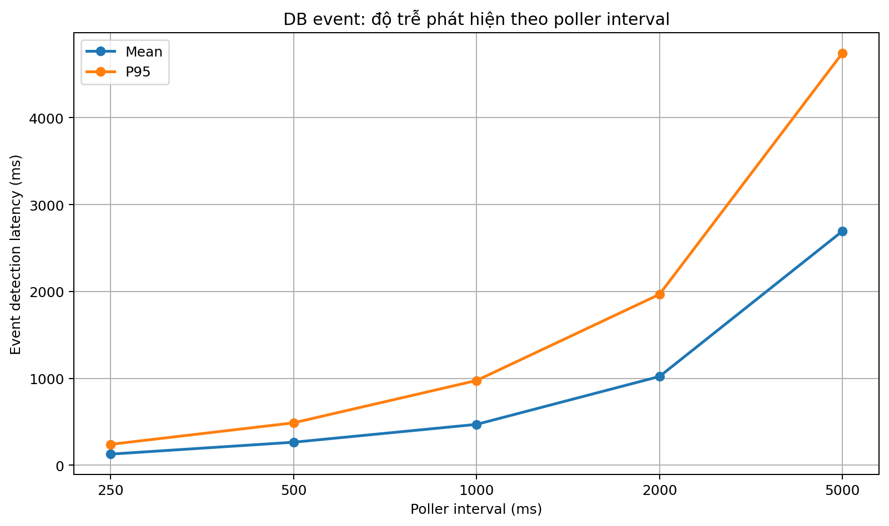
  <figcaption><i>Hình 1. Độ trễ phát hiện sự kiện theo chu kỳ poller</i></figcaption>
</figure>

<figure align="center">
  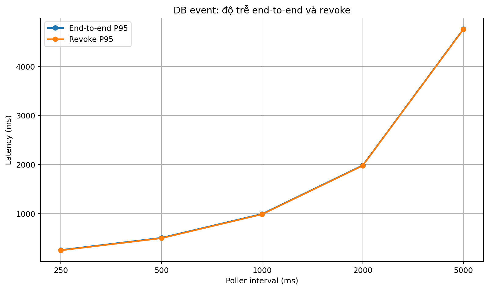
  <figcaption><i>Hình 2. Độ trễ toàn trình và độ trễ thu hồi theo chu kỳ poller</i></figcaption>
</figure>

## 1.3. Phân tích kết quả

Kết quả cho thấy chu kỳ poller ảnh hưởng trực tiếp đến thời gian hệ thống phát hiện một sự kiện cần tái đánh giá. Khi chu kỳ tăng từ `250 ms` lên `5000 ms`, độ trễ phát hiện trung bình tăng từ `128,0 ms` lên `2695,4 ms`, trong khi P95 tăng từ `240,4 ms` lên `4745,8 ms`.

Giá trị trung bình của độ trễ phát hiện nhìn chung nằm quanh khoảng một nửa chu kỳ poller. Điều này phù hợp với đặc điểm của cơ chế polling: nếu sự kiện xuất hiện ngay trước lần quét tiếp theo thì thời gian chờ ngắn, còn nếu xuất hiện ngay sau khi poller vừa chạy thì phải chờ gần một chu kỳ đầy đủ. Khi quan sát nhiều lần đo với thời điểm phát sinh sự kiện khác nhau, giá trị trung bình có xu hướng nằm gần giữa khoảng chờ đó.

P95 của độ trễ phát hiện lại tiến gần tới chính chu kỳ poller. Ở các trường hợp chậm, event có thể xuất hiện ngay sau khi một lượt quét vừa kết thúc nên phải chờ gần hết interval mới được lấy ra xử lý. Vì vậy, khi interval tăng, phần đuôi của phân bố độ trễ cũng tăng theo.

Ngược lại với detection latency, thời gian xử lý event sau khi poller đã lấy event gần như không thay đổi giữa các cấu hình. Giá trị trung bình chỉ dao động khoảng `17,3–17,9 ms`, còn P95 nằm quanh `20 ms`. Thời gian tái đánh giá một phiên cũng khá ổn định, khoảng `6 ms`.

Điều này cho thấy việc tăng chu kỳ poller chủ yếu làm kéo dài thời gian chờ trước khi UCON Core bắt đầu xử lý, chứ không làm cho phần xử lý nội bộ của event trở nên chậm hơn.

Độ trễ thu hồi và độ trễ đầu-cuối cũng tăng theo chu kỳ poller. Hai giá trị này gần nhau vì phiên được chuyển sang `REVOKED` trong quá trình xử lý event, trước khi event được ghi nhận là hoàn tất tại `processed_at`. Khoảng chênh còn lại chỉ chiếm một phần nhỏ so với thời gian chờ poller.

### Nhận xét

Trong phạm vi phép đo, chu kỳ poller là yếu tố chi phối đáng kể độ trễ phản ứng của cơ chế event-driven. Chu kỳ càng ngắn thì sự kiện được phát hiện và phiên bị thu hồi càng sớm. Tuy nhiên, việc giảm interval cũng làm tăng tần suất hoạt động nền của poller, cần được xem xét cùng với kết quả của kịch bản tiếp theo.

---

# 2. Kịch bản 2: Chi phí polling khi không có sự kiện

## 2.1. Thiết lập thí nghiệm

Kịch bản này quan sát poller trong khoảng thời gian không có event chờ xử lý. Bộ đếm được đặt lại ở đầu mỗi lần đo, hệ thống chạy liên tục trong khoảng thời gian quan sát và ghi nhận tổng số lượt poller chạy, số lượt không tìm thấy event và tần suất chạy theo phút.

Chu kỳ poller vẫn được khảo sát ở năm mức:

```text
250 ms
500 ms
1000 ms
2000 ms
5000 ms
```

Khi không có event:

```text
eventsProcessed = 0
emptyPolls = pollRuns
```

Do poller sử dụng `fixedDelay`, chu kỳ thực tế bao gồm cả thời gian thực thi lượt poll trước và khoảng nghỉ đã cấu hình. Vì vậy, tần suất thực tế có thể thấp hơn giá trị lý thuyết:

$$
\texttt{pollerRunsPerMinute}
\le
\frac{60000}{\texttt{pollerIntervalMs}}
$$

## 2.2. Kết quả

| Chu kỳ (ms) | Lần quét/phút | Quét rỗng/phút | Lý thuyết/phút | Chu kỳ thực (ms) | Tỷ lệ đạt (%) |
|---:|---:|---:|---:|---:|---:|
| 250 | 233,59 | 233,59 | 240,0 | 256,86 | 97,33 |
| 500 | 117,59 | 117,59 | 120,0 | 510,24 | 97,99 |
| 1000 | 59,40 | 59,40 | 60,0 | 1010,16 | 98,99 |
| 2000 | 29,80 | 29,80 | 30,0 | 2013,56 | 99,33 |
| 5000 | 12,00 | 12,00 | 12,0 | 5000,35 | 99,99 |

<figure align="center">
  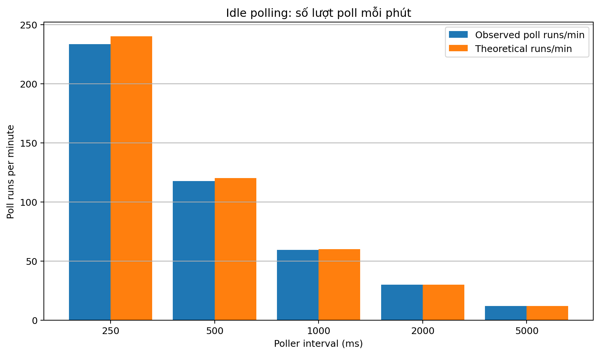
  <figcaption><i>Hình 3. Chi phí thăm dò khi không có sự kiện</i></figcaption>
</figure>

## 2.3. Phân tích kết quả

Khi chu kỳ poller ngắn, số lượt quét nền tăng mạnh. Với interval `250 ms`, hệ thống thực hiện khoảng `233,59` lượt quét mỗi phút. Ở mức `1000 ms`, số lượt giảm xuống khoảng `59,40` lượt/phút và ở `5000 ms` chỉ còn khoảng `12` lượt/phút.

Trong phép đo không có event, toàn bộ các lượt poll đều là quét rỗng. Vì vậy, việc giảm interval để có phản ứng nhanh hơn đồng thời làm tăng số lần backend phải truy vấn hàng đợi sự kiện dù không có công việc cần xử lý.

Số lượt chạy thực tế thấp hơn nhẹ so với lý thuyết ở các interval nhỏ. Nguyên nhân phù hợp với cơ chế `fixedDelay`: sau khi một lần poll hoàn thành, scheduler mới bắt đầu tính khoảng nghỉ trước lượt tiếp theo. Chi phí thực thi mỗi lần poll vì vậy làm chu kỳ thực tế dài hơn một ít so với interval cấu hình.

### Nhận xét

Kịch bản 1 và kịch bản 2 cho thấy một sự đánh đổi rõ ràng. Interval ngắn làm giảm độ trễ phát hiện và thu hồi, nhưng làm tăng hoạt động nền khi hệ thống không có event. Ngược lại, interval dài giảm số lượt quét rỗng nhưng làm event phải chờ lâu hơn trước khi được xử lý.

---

# 3. Lựa chọn chu kỳ poller đại diện

Để trực quan hóa sự đánh đổi giữa độ trễ thu hồi và chi phí polling nền, P95 của độ trễ thu hồi và số lượt quét rỗng mỗi phút được chuẩn hóa về cùng một thang đo.

| Chu kỳ (ms) | Phát hiện P95 | Thu hồi P95 | Quét rỗng/phút | Thu hồi chuẩn hóa | Quét rỗng chuẩn hóa | Độ lệch | Điểm cân bằng |
|---:|---:|---:|---:|---:|---:|---:|---:|
| 250 | 240,4 | 249,5 | 233,59 | 0,0525 | 1,0000 | 0,9475 | 1,0525 |
| 500 | 487,9 | 497,2 | 117,59 | 0,1046 | 0,5034 | 0,3988 | 0,6080 |
| 1000 | 975,1 | 984,5 | 59,40 | 0,2070 | 0,2543 | 0,0472 | 0,4613 |
| 2000 | 1967,3 | 1976,3 | 29,80 | 0,4156 | 0,1276 | 0,2881 | 0,5432 |
| 5000 | 4745,8 | 4754,9 | 12,00 | 1,0000 | 0,0514 | 0,9486 | 1,0514 |

<figure align="center">
  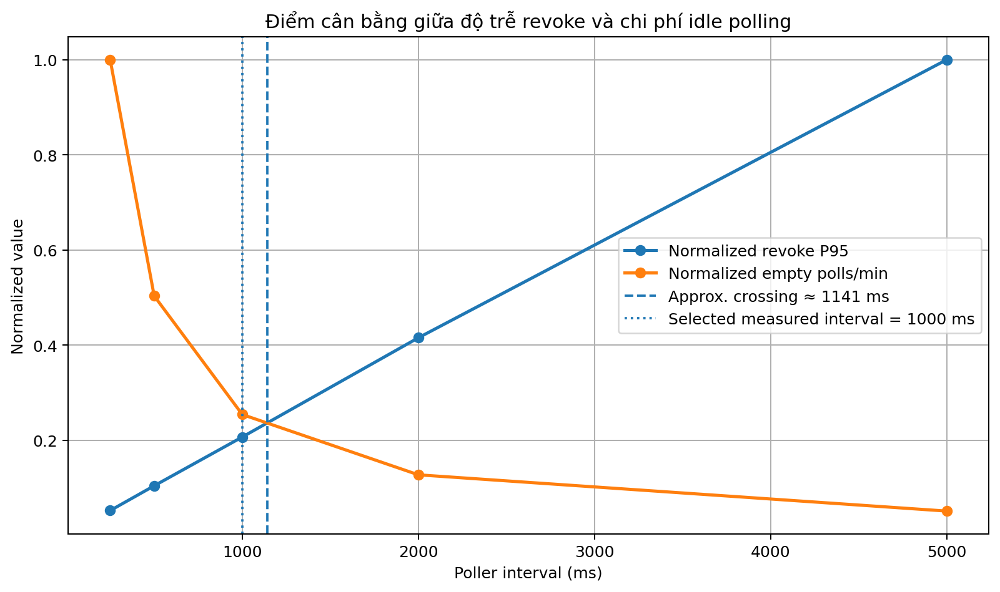
  <figcaption><i>Hình 4. Sự đánh đổi giữa độ trễ thu hồi và số lượt quét rỗng</i></figcaption>
</figure>

Trong tập các mức đã khảo sát, `1000 ms` nằm gần vùng mà hai yếu tố có mức tương đối cân bằng hơn so với các interval còn lại. Giá trị này không được xem là một optimum chung cho mọi hệ thống, mà chỉ được sử dụng như một cấu hình đại diện cho các phép đo tiếp theo trong bộ dữ liệu hiện tại.

---

# 4. Kịch bản 3: Ảnh hưởng của số phiên bị tác động

## 4.1. Thiết lập thí nghiệm

Chu kỳ poller được giữ cố định ở `1000 ms`. Hệ thống tạo đồng thời nhiều phiên `ACTIVE` cùng phụ thuộc vào một gói thuê. Số phiên được thay đổi theo:

```text
K = 1
K = 10
K = 50
K = 100
```

Sau khi tất cả phiên đã được kích hoạt, trạng thái của gói thuê được chuyển từ `ACTIVE` sang `CANCELLED`.

Luồng xử lý:

```text
Tạo K phiên ACTIVE cùng phụ thuộc một gói thuê
→ đổi trạng thái gói thuê ACTIVE → CANCELLED
→ DB tạo một ATTRIBUTE_CHANGED
→ poller lấy event
→ xác định K phiên liên quan
→ tái đánh giá từng phiên
→ các phiên không còn hợp lệ chuyển sang REVOKED
```

Một iteration chỉ được xem là hợp lệ khi số phiên bị ảnh hưởng và số phiên bị thu hồi bằng đúng số phiên được yêu cầu.

## 4.2. Các chỉ số chính

Ngoài `event_processing_latency_ms`, kịch bản sử dụng thêm:

$$
\texttt{reevaluation\_total\_ms}
=
\sum_{i=1}^{K} r_i
$$

với \(r_i\) là thời gian tái đánh giá của phiên thứ \(i\).

Thời gian tái đánh giá trung bình trên mỗi phiên:

$$
\texttt{reevaluation\_mean\_ms}
=
\frac{\texttt{reevaluation\_total\_ms}}{K}
$$

Phần chi phí xử lý còn lại ngoài tổng thời gian tái đánh giá:

$$
\texttt{non\_reevaluation\_overhead\_ms}
=
\texttt{event\_processing\_latency\_ms}
-
\texttt{reevaluation\_total\_ms}
$$

Chỉ số này chỉ là phần chênh ở mức tổng hợp. Nó chưa cho biết chi tiết phần thời gian còn lại thuộc Dependency Lookup, cập nhật trạng thái, xử lý POST, ghi dữ liệu hay các bước điều phối khác.

## 4.3. Kết quả

| Số phiên | Số mẫu | Xử lý TB | Xử lý P95 | Xử lý lớn nhất | Tổng tái đánh giá TB | Tổng tái đánh giá P95 | Tái đánh giá/phiên | Chi phí ngoài tái đánh giá | Thu hồi P95 TB | Thu hồi lớn nhất TB | Độ chênh TB | Độ chênh P95 |
|---:|---:|---:|---:|---:|---:|---:|---:|---:|---:|---:|---:|---:|
| 1 | 100 | 18,3 | 21,2 | 24,4 | 6,6 | 7,8 | 6,617 | 11,7 | 525,3 | 525,3 | 0,0 | 0,0 |
| 10 | 100 | 107,7 | 118,7 | 123,9 | 41,2 | 46,1 | 4,122 | 66,5 | 566,0 | 569,9 | 42,6 | 47,2 |
| 50 | 100 | 414,1 | 436,2 | 452,7 | 158,3 | 168,2 | 3,167 | 255,7 | 937,2 | 955,8 | 188,0 | 202,2 |
| 100 | 100 | 789,5 | 834,3 | 1010,3 | 300,1 | 323,4 | 3,001 | 489,4 | 1239,3 | 1276,5 | 374,3 | 393,7 |

<figure align="center">
  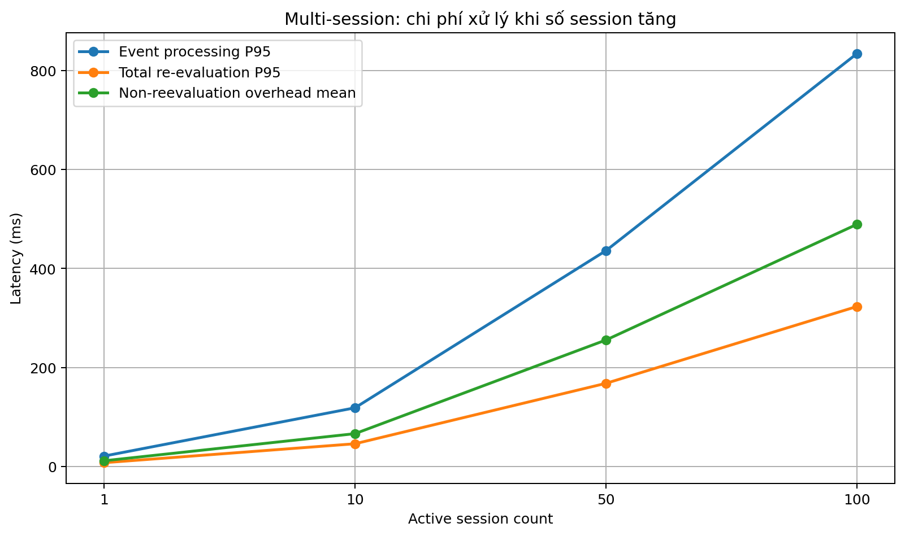
  <figcaption><i>Hình 5. Thời gian xử lý khi số phiên bị ảnh hưởng tăng</i></figcaption>
</figure>

<figure align="center">
  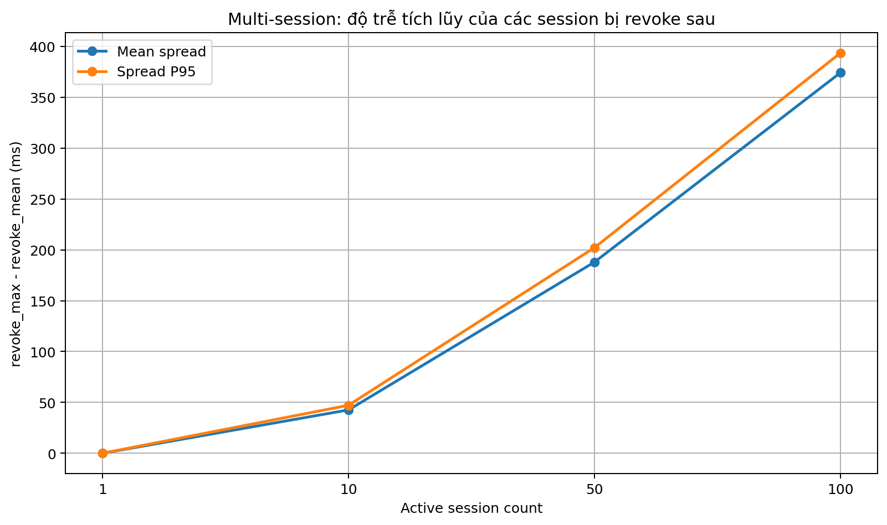
  <figcaption><i>Hình 6. Độ chênh thời gian thu hồi giữa các phiên</i></figcaption>
</figure>

## 4.4. Phân tích kết quả

Kết quả cho thấy thời gian UCON Core xử lý một event tăng rõ rệt khi số phiên bị ảnh hưởng tăng. Thời gian xử lý trung bình tăng từ `18,3 ms` ở mức một phiên lên `107,7 ms` với 10 phiên, `414,1 ms` với 50 phiên và `789,5 ms` với 100 phiên. P95 cũng tăng từ `21,2 ms` lên `834,3 ms`.

Xu hướng này cho thấy sau khi event đã được poller lấy ra, số lượng phiên liên quan trở thành một yếu tố quan trọng đối với chi phí xử lý. Mỗi phiên cần được lấy thông tin cần thiết, tái đánh giá chính sách và thực hiện các bước xử lý tiếp theo nếu quyết định không còn cho phép.

Tổng thời gian tái đánh giá cũng tăng theo K, từ trung bình `6,6 ms` ở mức một phiên lên `300,1 ms` ở mức 100 phiên. Đây là xu hướng phù hợp với việc hệ thống phải thực hiện thêm một lần reevaluation cho mỗi phiên bị ảnh hưởng.

Tuy nhiên, thời gian tái đánh giá trung bình trên từng phiên lại giảm từ `6,617 ms` xuống còn khoảng `3,001 ms`. Dữ liệu cho thấy việc xử lý nhiều phiên liên tiếp trong cùng event có thể làm giảm một số chi phí cố định trên từng phiên. Tuy nhiên, phép đo hiện tại chưa tách chi tiết các thành phần bên trong reevaluation nên chưa đủ cơ sở để xác định chính xác nguyên nhân.

Phần `non_reevaluation_overhead_ms` cũng tăng mạnh, từ `11,7 ms` ở mức một phiên lên `489,4 ms` ở mức 100 phiên. Phần này có thể bao gồm các công việc như xác định phiên bị ảnh hưởng, lấy dữ liệu phiên, cập nhật trạng thái, ghi dữ liệu, xử lý sau sử dụng và hoàn tất event. Vì đây chỉ là hiệu số giữa hai metric tổng hợp, không nên xem nó như một bước xử lý độc lập.

Trong phạm vi các mức K đã khảo sát, thời gian xử lý event và tổng reevaluation có xu hướng tăng gần tuyến tính khi K tăng. Tuy nhiên, benchmark này chỉ cho thấy xu hướng thực nghiệm tại các mức đã đo, không dùng để kết luận độ phức tạp thuật toán theo nghĩa toán học.

## 4.5. Độ chênh thời gian thu hồi giữa các phiên

Khi một event tác động đến nhiều phiên, các phiên không được hoàn tất tại cùng một thời điểm. Phiên được xử lý sớm hơn có thể chuyển sang `REVOKED` trước phiên nằm ở cuối chuỗi xử lý.

Độ chênh trung bình tăng từ `0 ms` ở K=1 lên khoảng `42,6 ms` ở K=10, `188,0 ms` ở K=50 và `374,3 ms` ở K=100. Điều này phản ánh tác động của cách xử lý nhiều phiên trong cùng một event: khi K tăng, khoảng thời gian giữa các phiên hoàn tất sớm và muộn cũng tăng.

### Nhận xét

Kịch bản 3 xác nhận rằng một event ảnh hưởng đến càng nhiều phiên thì tổng chi phí xử lý càng lớn. Tuy nhiên, phép đo này mới chỉ cho biết tổng processing time, tổng reevaluation và phần chênh ngoài reevaluation. Nó chưa trả lời được thành phần nào bên trong UCON Core chiếm tỷ trọng lớn nhất.

Đây là hạn chế quan trọng của phép đo cũ và là cơ sở để thực hiện một kịch bản phân rã chi tiết hơn ở bước tiếp theo.

---

# 5. Kịch bản 4: Ảnh hưởng của chu kỳ scheduler trong cơ chế timer-based

## 5.1. Thiết lập thí nghiệm

Kịch bản tạo một gói thuê có thời điểm hết hạn gần thời điểm thực hiện phép đo, sau đó tạo một phiên `ACTIVE` phụ thuộc vào mốc hết hạn đó.

Luồng xử lý:

```text
Gói thuê đến hạn
→ dependency next_check_at đến hạn
→ scheduler phát hiện
→ scheduler tạo TIMER_DUE
→ poller lấy TIMER_DUE
→ UCON Core tái đánh giá
→ phiên chuyển sang REVOKED
```

Chu kỳ poller được giữ cố định ở `1000 ms`. Chu kỳ scheduler được thay đổi ở các mức `250`, `500`, `1000`, `2000` và `5000 ms`. Mỗi mức được đo 100 mẫu.

## 5.2. Các thành phần độ trễ

Đối với timer-based, tổng độ trễ thu hồi có thể hiểu theo ba phần chính:

```text
mốc hết hạn
→ chờ scheduler phát hiện
→ chờ poller lấy TIMER_DUE
→ UCON Core xử lý và thu hồi
```

Trong đó:

- `timer_detection_latency_ms`: từ `dependency_due_at` đến lúc scheduler tạo event;
- `timer_event_detection_latency_ms`: thời gian event `TIMER_DUE` chờ poller;
- `timer_event_processing_latency_ms`: thời gian backend xử lý sau khi poller lấy event;
- `timer_total_revoke_latency_ms`: từ mốc đến hạn đến lúc session chuyển `REVOKED`.

## 5.3. Kết quả

| Chu kỳ scheduler (ms) | Số mẫu | Phát hiện hạn TB | Phát hiện hạn P95 | Poller lấy event TB | Poller lấy event P95 | Xử lý TB | Xử lý P95 | Tổng thu hồi TB | Tổng thu hồi P95 | Tái đánh giá TB | Tái đánh giá P95 |
|---:|---:|---:|---:|---:|---:|---:|---:|---:|---:|---:|---:|
| 250 | 100 | 137,2 | 248,8 | 746,7 | 909,2 | 18,4 | 21,1 | 893,9 | 994,4 | 6,69 | 7,92 |
| 500 | 100 | 282,6 | 486,2 | 457,5 | 832,8 | 18,6 | 21,1 | 750,1 | 992,0 | 6,74 | 7,92 |
| 1000 | 100 | 452,5 | 946,0 | 1009,4 | 1014,1 | 18,2 | 21,2 | 1471,3 | 1967,2 | 6,50 | 7,68 |
| 2000 | 100 | 1030,7 | 1963,6 | 471,5 | 923,4 | 18,6 | 21,5 | 1512,2 | 2390,3 | 6,69 | 7,80 |
| 5000 | 100 | 2180,6 | 4710,9 | 476,0 | 932,7 | 18,3 | 20,8 | 2666,3 | 5286,7 | 6,58 | 7,64 |

<figure align="center">
  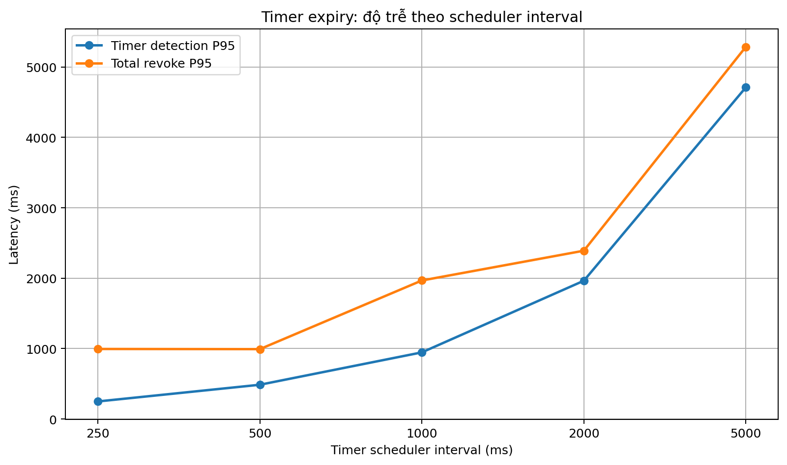
  <figcaption><i>Hình 7. Độ trễ thu hồi theo chu kỳ scheduler</i></figcaption>
</figure>

<figure align="center">
  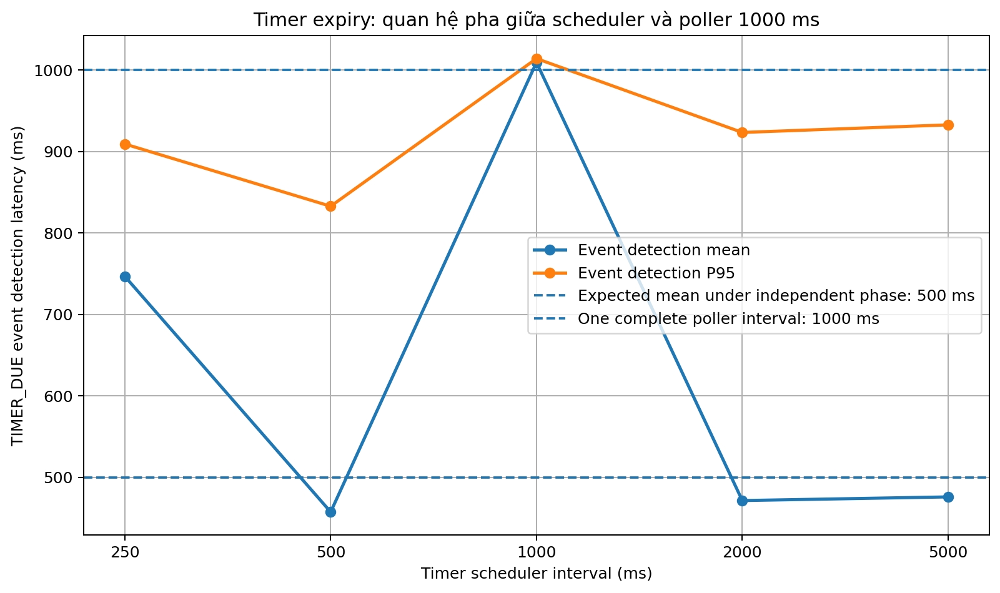
  <figcaption><i>Hình 8. Tương tác thời điểm thực thi giữa scheduler và poller</i></figcaption>
</figure>

## 5.4. Phân tích kết quả

Độ trễ để scheduler phát hiện mốc đến hạn tăng khi scheduler interval tăng. P95 của `timer_detection_latency_ms` tăng từ khoảng `248,8 ms` ở chu kỳ `250 ms` lên `4710,9 ms` ở chu kỳ `5000 ms`.

Khi scheduler phát hiện dependency đến hạn, event `TIMER_DUE` vẫn chưa được xử lý ngay mà phải chờ poller lấy ra. Vì poller được cố định ở `1000 ms`, phần chờ này có thể tiếp tục đóng góp gần một giây vào tổng latency.

Trường hợp đáng chú ý nhất là khi scheduler và poller đều có chu kỳ `1000 ms`. Ở mức này, thời gian event chờ poller trung bình khoảng `1009,4 ms` và P95 khoảng `1014,1 ms`, tức gần trọn một chu kỳ poller. Kết quả cho thấy thời điểm scheduler tạo event có thể rơi vào vị trí không thuận lợi so với lần quét của poller, làm event phải chờ gần một interval đầy đủ mới được lấy ra.

Do đó, P95 của tổng độ trễ thu hồi tại scheduler `1000 ms` tăng lên gần `1967,2 ms`. Ngược lại, tại scheduler `500 ms`, P95 tổng thu hồi chỉ khoảng `992,0 ms`.

Ở các mức scheduler `2000 ms` và `5000 ms`, thời gian event chờ poller trung bình quay về khoảng `472–476 ms`, gần một nửa chu kỳ poller. Tuy nhiên, P95 vẫn đạt hơn `900 ms`, cho thấy ở các mẫu chậm event vẫn có thể phải chờ gần lần poll tiếp theo.

Một điểm quan trọng là thời gian processing bên trong backend gần như không đổi giữa các cấu hình, chỉ khoảng `18 ms`, còn reevaluation khoảng `6,5–6,7 ms`. Như vậy, phần tăng của tổng latency chủ yếu đến từ hai tầng chờ định kỳ: scheduler và poller, không phải vì UCON Core xử lý policy chậm hơn khi scheduler interval thay đổi.

### Nhận xét

Độ trễ của cơ chế timer-based phụ thuộc đồng thời vào chu kỳ scheduler và chu kỳ poller. Hai tham số này cần được xem xét phối hợp thay vì cấu hình độc lập. Trong bộ dữ liệu này, cấu hình scheduler `500 ms` kết hợp poller `1000 ms` cho kết quả tổng latency tốt hơn trường hợp hai chu kỳ cùng `1000 ms`.

---

# 6. Khoảng thời gian hoàn tất sau khi phiên bị thu hồi

Sau khi phiên chuyển sang trạng thái `REVOKED`, UCON Core vẫn cần một khoảng thời gian nhỏ để hoàn tất các bước còn lại của event trước khi ghi nhận `processed_at`.

| Chỉ số | Giá trị (ms) |
|---|---:|
| Trung bình | 8,586 |
| Trung vị | 8,558 |
| P95 | 10,245 |
| Nhỏ nhất | 4,533 |
| Lớn nhất | 18,360 |

<figure align="center">
  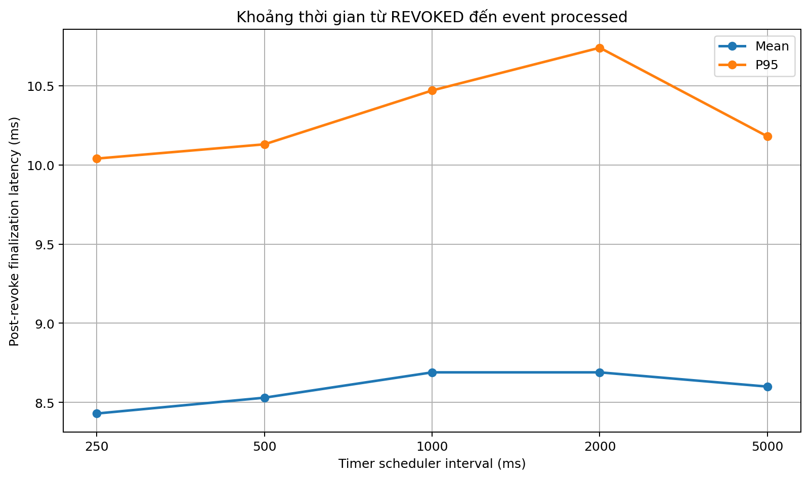
  <figcaption><i>Hình 9. Khoảng thời gian hoàn tất sau khi phiên chuyển sang REVOKED</i></figcaption>
</figure>

Khoảng thời gian này trung bình khoảng `8,59 ms` và P95 khoảng `10,25 ms`. So với các khoảng chờ scheduler và poller, đây là phần tương đối nhỏ.

Chu kỳ scheduler ảnh hưởng đến thời điểm event bắt đầu được xử lý, nhưng gần như không làm thay đổi phần thời gian hoàn tất sau khi session đã chuyển sang `REVOKED`.

---

# 7. Phân tích bổ sung: ảnh hưởng của xử lý POST

Bộ dữ liệu cũ có thêm phép so sánh trước và sau khi bật xử lý `postUpdate`.

<figure align="center">
  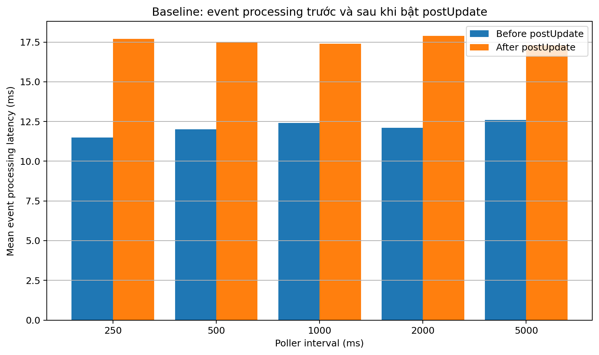
  <figcaption><i>Hình 10. Thời gian xử lý một phiên trước và sau khi bật postUpdate</i></figcaption>
</figure>

<figure align="center">
  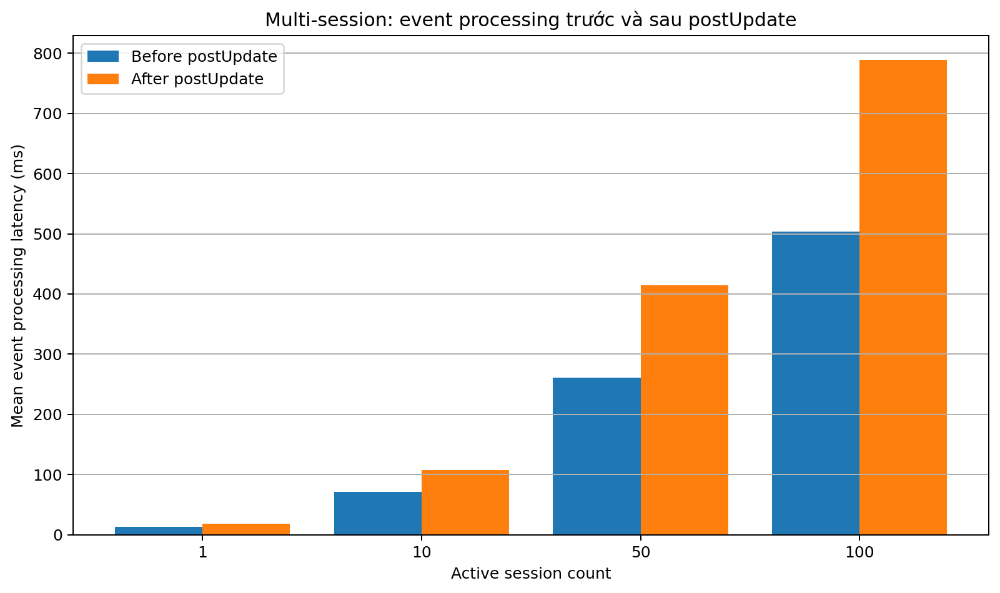
  <figcaption><i>Hình 11. Thời gian xử lý nhiều phiên trước và sau khi bật postUpdate</i></figcaption>
</figure>

<figure align="center">
  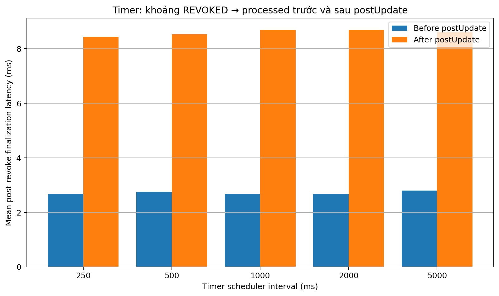
  <figcaption><i>Hình 12. Khoảng hoàn tất sau thu hồi trước và sau khi bật postUpdate</i></figcaption>
</figure>

Kết quả cho thấy thời gian processing tăng sau khi bổ sung `postUpdate`. Trong trường hợp một phiên, mức tăng khoảng `5–6 ms` và tương đối ổn định giữa các chu kỳ poller.

Khi số phiên bị ảnh hưởng tăng, phần chênh trở nên rõ hơn. Ở mức 100 phiên, thời gian xử lý trung bình tăng từ khoảng `503,3 ms` trước khi bật `postUpdate` lên `789,5 ms` sau khi bật.

Khoảng thời gian từ khi session chuyển sang `REVOKED` đến khi event được đánh dấu xử lý hoàn tất cũng tăng từ khoảng `2,71 ms` lên `8,59 ms`.

Tuy nhiên, không thể xem toàn bộ phần chênh lệch này là thời gian thực thi riêng của `postUpdate`. Khoảng đo còn bao gồm các bước khác như cập nhật trạng thái, ghi dữ liệu, điều phối xử lý và hoàn tất giao dịch. Vì vậy, kết quả chỉ cho thấy việc bổ sung xử lý hậu sử dụng làm tăng tổng chi phí event, đặc biệt khi một event ảnh hưởng đến nhiều phiên.

### Nhận xét

Phép so sánh before/after cho thấy POST processing là một yếu tố cần được quan tâm, nhưng dữ liệu cũ chưa đủ chi tiết để xác định chính xác phần thời gian nào thuộc đánh giá chính sách POST, cập nhật thuộc tính hay các thao tác khác.

---

# 8. Kịch bản 5: Phân rã chi phí xử lý bên trong UCON Core

## 8.1. Mục tiêu

Kịch bản 5 tập trung vào phần thời gian xử lý **sau khi poller đã lấy event**. Mục tiêu là trả lời ba câu hỏi:

1. `total_core_ms` thay đổi như thế nào khi số phiên bị ảnh hưởng K tăng?
2. Bên trong UCON Core, thời gian chủ yếu được dùng cho Dependency Lookup, PIP, PDP, cập nhật trạng thái, POST processing hay các bước phụ trợ khác?
3. Khi đặt thời gian Core cạnh `poller_wait_ms`, thành phần nào chi phối độ trễ đầu-cuối ở từng mức K?

Kịch bản này chỉ đánh giá backend/UCON Core. Phần WebSocket gửi thông báo sau commit và thời gian render phía UI nằm ngoài phạm vi đo.

## 8.2. Thiết lập thí nghiệm

Cấu hình được giữ cố định:

```text
poller interval    = 1000 ms
scheduler interval = 500 ms
trigger event      = user_rentals.status: ACTIVE → CANCELLED
K                   = 1, 10, 50, 100
```

Mỗi mức K được chạy thành hai batch chính thức, mỗi batch 50 event. Sau khi gộp hai batch, mỗi mức K có 100 event-level summary rows, tổng cộng 400 event.

Dữ liệu CSV được đọc từ:

```text
D:\Work\Study\Learning\KLTN\Ucon_ABC\ucon_app_refactor_project_structure_new\src\measurement-scripts\kb5
```

Luồng thời gian được hiểu như sau:

```text
DB tạo ATTRIBUTE_CHANGED
→ event chờ poller                         = poller_wait_ms
→ poller lấy event
→ UCON Core xử lý:
     Dependency Lookup
     PIP
     PDP
     Revoke Update
     POST Processing
     Revoke Publish
     các thao tác Core chưa có timer riêng
→ Context Handler trả kết quả              = total_core_ms
→ backend hoàn tất event                   = event_processing_latency_ms
```

Do đó:

```text
event_end_to_end_latency_ms
= poller_wait_ms + event_processing_latency_ms
```

và:

```text
total_core_ms
= measured_component_sum_ms + unattributed_core_ms
```

Trong đó:

```text
measured_component_sum_ms
= dependency_lookup_ms
+ pip_fetch_ms
+ pdp_evaluate_ms
+ revoke_update_ms
+ post_processing_ms
+ revoke_publish_ms
```

`reevaluation_total_ms` không được cộng thêm vào công thức trên vì nó chồng lặp với PIP, PDP và các công việc khác bên trong reevaluation.

## 8.3. Kiểm tra tính hợp lệ của dữ liệu

Toàn bộ 400 summary event của kịch bản 5 đều có `success=True`. Ở mỗi mức K, `affected_session_count` bằng đúng `requested_session_count`, và các detail rows tương ứng kết thúc ở trạng thái `REVOKED`.

Các quan hệ số học trong instrumentation cũng khớp với dữ liệu:

```text
event_end_to_end_latency_ms
= poller_wait_ms + event_processing_latency_ms
```

```text
total_core_ms
= measured_component_sum_ms + unattributed_core_ms
```

Sai số chỉ ở mức làm tròn số thập phân. Vì vậy, `total_core_ms` có thể được sử dụng làm metric chính để phân tích chi phí bên trong Core.

Khi cần liên kết summary và details, `trigger_event_id` chỉ nên được dùng trong **cùng batch tương ứng**, vì ID này có thể lặp giữa các batch khác nhau.

## 8.4. Kết quả tổng quan

Bảng sau tổng hợp các metric chính ở cấp event:

| K | Poller Wait TB | Event Processing TB | total_core TB | total_core Median | total_core P95 | total_core SD | E2E TB |
|---:|---:|---:|---:|---:|---:|---:|---:|
| 1 | 544,97 | 16,74 | 16,13 | 15,81 | 19,38 | 2,34 | 561,71 |
| 10 | 505,52 | 103,72 | 103,21 | 102,67 | 116,94 | 8,58 | 609,24 |
| 50 | 512,87 | 415,57 | 415,03 | 419,36 | 435,69 | 17,35 | 928,45 |
| 100 | 560,09 | 786,84 | 786,27 | 794,32 | 818,21 | 27,66 | 1346,93 |

Bảng breakdown trung bình của `total_core_ms`:

| K | Dependency Lookup | PIP | PDP | Revoke Update | POST Processing | Revoke Publish | Chưa phân rã |
|---:|---:|---:|---:|---:|---:|---:|---:|
| 1 | 0,63 | 3,72 | 0,25 | 0,46 | 6,03 | 0,08 | 4,95 |
| 10 | 0,95 | 26,90 | 0,65 | 2,67 | 43,10 | 0,14 | 28,81 |
| 50 | 1,85 | 107,97 | 1,80 | 10,79 | 177,93 | 0,44 | 114,25 |
| 100 | 2,19 | 205,18 | 2,98 | 20,45 | 337,94 | 0,76 | 216,78 |

<figure align="center">
  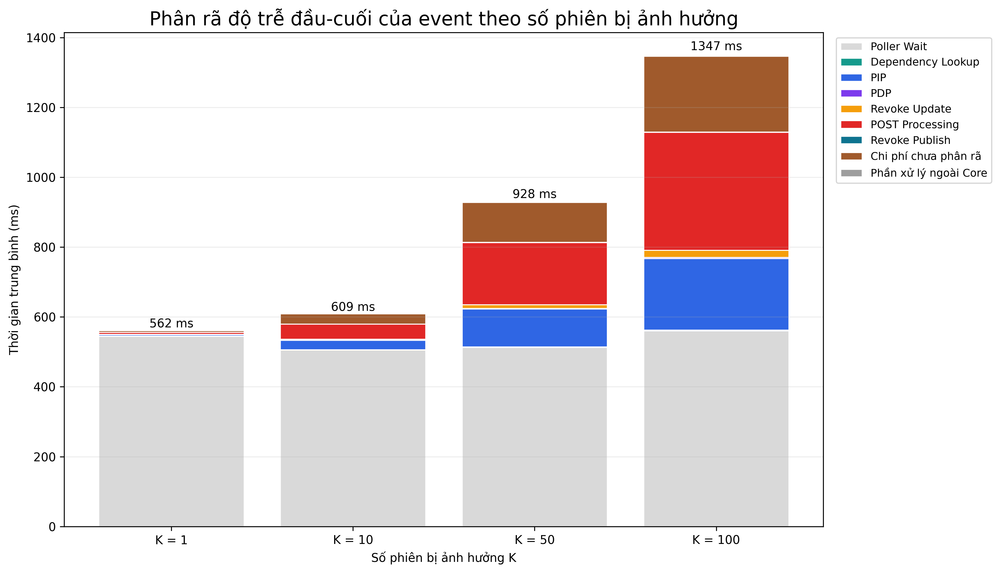
  <figcaption><i>Hình 13. Phân rã độ trễ đầu-cuối của event, gồm Poller Wait và các thành phần xử lý UCON Core</i></figcaption>
</figure>

<figure align="center">
  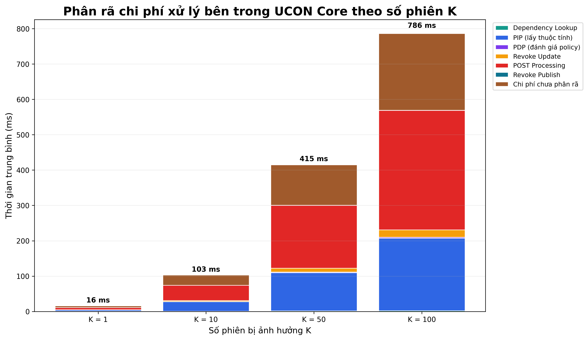
  <figcaption><i>Hình 14. Phân rã total_core_ms theo số phiên bị ảnh hưởng K, không gồm Poller Wait</i></figcaption>
</figure>

## 8.5. Poller Wait và chi phí xử lý Core trong độ trễ đầu-cuối

Hình 13 tách phần thời gian chờ poller khỏi các thành phần xử lý bên trong UCON Core. `poller_wait_ms` được giữ bằng màu xám vì không nằm trong `total_core_ms`, trong khi các phần thuộc UCON Core được biểu diễn bằng các màu riêng.

Mặc dù poller interval được giữ cố định ở `1000 ms`, `poller_wait_ms` trung bình dao động từ khoảng `505,52 ms` đến `560,09 ms` giữa các mức K. Không nên diễn giải sự dao động này là do K làm poller chậm hơn. `poller_wait_ms` phụ thuộc chủ yếu vào vị trí thời điểm event được tạo trong chu kỳ polling và biến thiên scheduling giữa các lần đo. Với poller `1000 ms`, giá trị trung bình quanh khoảng nửa chu kỳ là phù hợp với cơ chế polling.

Trong khi Poller Wait chỉ dao động nhẹ, `total_core_ms` tăng rõ rệt:

```text
K=1     :  16,13 ms
K=10    : 103,21 ms
K=50    : 415,03 ms
K=100   : 786,27 ms
```

Vì vậy, mức tăng của E2E khi K lớn chủ yếu đến từ phần xử lý Core chứ không phải từ việc Poller Wait tăng tương ứng.

Tỷ trọng tương đối cũng thay đổi đáng kể:

```text
K=1   : Poller Wait ≈ 97,02% E2E ; total_core ≈ 2,87%
K=10  : Poller Wait ≈ 82,98% E2E ; total_core ≈ 16,94%
K=50  : Poller Wait ≈ 55,24% E2E ; total_core ≈ 44,70%
K=100 : Poller Wait ≈ 41,58% E2E ; total_core ≈ 58,37%
```

Ở K nhỏ, độ trễ đầu-cuối chủ yếu là thời gian event chờ poller. Khi K tăng lên 100, phần xử lý bên trong UCON Core đã lớn hơn Poller Wait. Điều này cho thấy với event ảnh hưởng nhiều phiên, chỉ giảm poller interval sẽ không đủ để giảm mạnh E2E; chi phí xử lý bên trong Core trở thành yếu tố quan trọng hơn.

Một điểm khác là `event_processing_latency_ms` gần như trùng với `total_core_ms`. Chênh lệch trung bình chỉ khoảng `0,51–0,61 ms/event` ở bốn mức K. Phần chênh nhỏ này phản ánh outer backend overhead quanh quá trình xử lý event, ví dụ bookkeeping hoặc bước đánh dấu event đã xử lý, chứ không phải một thành phần lớn của Core.

## 8.6. Phân rã chi phí bên trong UCON Core

Hình 14 loại hoàn toàn Poller Wait để chỉ quan sát `total_core_ms`. Khi K tăng, ba nhóm tăng mạnh nhất là POST Processing, PIP và `unattributed_core_ms`.

Ở `K=100`:

```text
POST Processing      = 337,94 ms
Unattributed Core    = 216,78 ms
PIP Fetch            = 205,18 ms
Revoke Update        =  20,45 ms
PDP Evaluate         =   2,98 ms
Dependency Lookup    =   2,19 ms
Revoke Publish       =   0,76 ms
```

Như vậy, **POST Processing là thành phần được instrument riêng có thời gian lớn nhất**. PIP và phần chi phí Core chưa được phân rã cũng đóng góp đáng kể. Ngược lại, thời gian PDP nhỏ so với tổng Core time; ở K=100 chỉ khoảng `2,98 ms`.

Kết quả này cần được hiểu đúng theo phạm vi timer. `pdp_evaluate_ms` chỉ đo phần AuthzForce/PDP thực hiện ONGOING policy evaluation, không đại diện cho toàn bộ reevaluation. Do đó không nên đồng nhất “reevaluation” với “PDP”.

`dependency_lookup_ms` là timer cấp event và tăng từ khoảng `0,63 ms` ở K=1 lên `2,19 ms` ở K=100. Giá trị tuyệt đối vẫn nhỏ so với tổng Core time. Kịch bản 5 chỉ cho thấy lookup không phải thành phần chi phối khi K tăng; việc đánh giá ảnh hưởng của tổng số session N được xử lý riêng ở kịch bản 6.

`revoke_publish_ms` cũng rất nhỏ và chỉ đo thời gian Context Handler phát **application event nội bộ**. Nó không phải thời gian truyền WebSocket đến PEP/UI.

## 8.7. Tỷ trọng các thành phần trong total_core_ms

<figure align="center">
  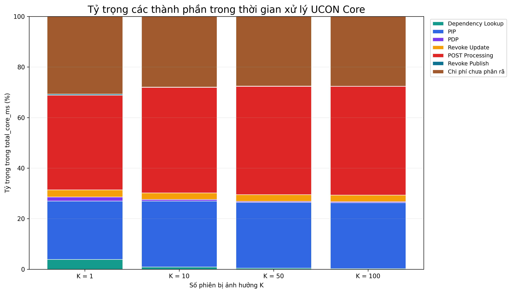
  <figcaption><i>Hình 15. Tỷ trọng các thành phần chi phí trong total_core_ms</i></figcaption>
</figure>

Tỷ trọng các thành phần cho thấy cơ cấu chi phí tương đối ổn định từ K=10 trở lên:

| Thành phần | K=1 | K=10 | K=50 | K=100 |
|---|---:|---:|---:|---:|
| Dependency Lookup | 3,92% | 0,92% | 0,45% | 0,28% |
| PIP | 23,09% | 26,06% | 26,01% | 26,10% |
| PDP | 1,57% | 0,63% | 0,43% | 0,38% |
| Revoke Update | 2,87% | 2,59% | 2,60% | 2,60% |
| POST Processing | 37,41% | 41,76% | 42,87% | 42,98% |
| Revoke Publish | 0,47% | 0,14% | 0,11% | 0,10% |
| Chưa phân rã | 30,67% | 27,91% | 27,53% | 27,57% |

Từ K=10 đến K=100, POST Processing duy trì quanh `42–43%`, PIP quanh `26%` và phần chưa phân rã quanh `27–28%`. Ba nhóm này cộng lại chiếm khoảng `96–97%` `total_core_ms` ở các mức K lớn.

PDP, Dependency Lookup và Revoke Publish đều có tỷ trọng nhỏ. Vì vậy, trong phạm vi benchmark này, sự tăng của `total_core_ms` không tập trung tại policy engine mà chủ yếu nằm ở các bước lấy dữ liệu, xử lý POST và các thao tác Core phụ trợ chưa được đặt timer riêng.

`unattributed_core_ms` vẫn là thời gian **bên trong UCON Core**, không phải một stage kiến trúc riêng. Dựa trên luồng xử lý hiện tại, phần này có thể bao gồm chi phí điều phối của `ContextHandler`, một số thao tác của `UsageSessionManager`, truy vấn session/dependency/policy metadata, kiểm tra trạng thái, dựng request/context, ghi `session_events` và các truy vấn cơ sở dữ liệu phụ trợ. Không có WebSocket/UI trong phần thời gian này.

## 8.8. Độ ổn định của total_core_ms

<figure align="center">
  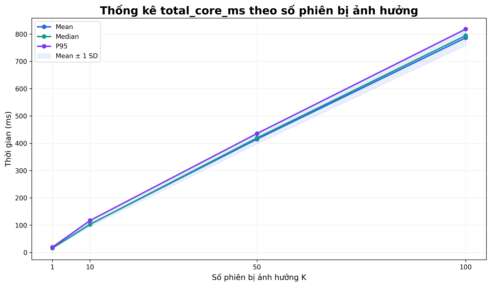
  <figcaption><i>Hình 16. Mean, median, P95 và độ phân tán của total_core_ms theo K</i></figcaption>
</figure>

`total_core_ms` tăng rõ rệt theo K, đồng thời mean, median và P95 ở từng mức tương đối gần nhau. Ở `K=100`, mean là `786,27 ms`, median `794,32 ms` và P95 `818,21 ms`; P95 chỉ cao hơn mean khoảng `4,1%`.

Standard deviation tăng theo giá trị tuyệt đối khi K lớn hơn, nhưng tỷ lệ SD/mean lại giảm từ khoảng `14,5%` ở K=1 xuống khoảng `3,5%` ở K=100. Điều này cho thấy các event ở mức K lớn có thời gian xử lý tương đối tập trung quanh giá trị điển hình.

Trong phạm vi bốn mức K đã đo, `total_core_ms` có xu hướng tăng gần tuyến tính theo số phiên bị ảnh hưởng. Tuy nhiên, đây chỉ là quan sát thực nghiệm của benchmark và không được dùng để kết luận độ phức tạp thuật toán theo nghĩa toán học.

### Nhận xét

Kịch bản 5 cho thấy hai lớp chi phí khác nhau cần được tách biệt:

- `poller_wait_ms` quyết định phần lớn E2E khi số phiên bị ảnh hưởng nhỏ nhưng nằm ngoài `total_core_ms`;
- khi K tăng, `total_core_ms` tăng mạnh và dần trở thành phần lớn hơn của E2E.

Bên trong UCON Core, POST Processing là component được instrument riêng có thời gian lớn nhất, tiếp theo là PIP và phần `unattributed_core_ms`. PDP evaluation, Dependency Lookup và Revoke Publish chỉ chiếm tỷ trọng nhỏ trong benchmark này.

Do đó, nếu tiếp tục tối ưu hoặc instrument sâu hơn, ưu tiên hợp lý là phân tích kỹ POST Processing, PIP và phần `unattributed_core_ms`, thay vì giả định policy engine là nguyên nhân chính. Mọi kết luận ở đây chỉ áp dụng cho backend/UCON Core; WebSocket và UI không nằm trong phạm vi kịch bản 5.

---


# 9. Kịch bản 6: Ảnh hưởng của tổng số phiên đang hoạt động (N)

Kịch bản 5 cho thấy chi phí tăng theo số phiên **bị ảnh hưởng** K. Một câu hỏi khác quan trọng không kém với khả năng mở rộng của hệ thống: khi tổng số phiên **đang hoạt động** trong hệ thống (N) tăng lên nhưng số phiên thực sự bị ảnh hưởng vẫn nhỏ, chi phí xử lý một event có tăng theo không? Nếu có, hệ thống sẽ khó mở rộng khi lượng người dùng đồng thời lớn. Kịch bản 6 được thiết kế để trả lời câu hỏi này.

## 9.1. Thiết lập thí nghiệm

Cấu hình cố định:

```text
poller interval    = 1000 ms
scheduler interval = 500 ms
K (số phiên bị ảnh hưởng) = 10   (cố định)
N (tổng phiên ACTIVE)     = 100, 500, 1000
```

Ở mỗi mức N, hệ thống tạo `N - K` phiên nền (background) đang `ACTIVE` nhưng **không** phụ thuộc vào gói thuê mục tiêu, cùng với đúng `K = 10` phiên phụ thuộc vào gói thuê đó. Khi gói thuê bị hủy, chỉ 10 phiên mục tiêu được kỳ vọng chuyển sang `REVOKED`, còn toàn bộ phiên nền phải tiếp tục `ACTIVE`. Mỗi mức N được đo 100 mẫu ở cấp event.

Điều kiện hợp lệ của một mẫu:

```text
active_sessions_before_event   = N
measured_affected_session_count = 10
active_sessions_after_event    = N - 10
10 phiên mục tiêu → REVOKED
các phiên nền     → vẫn ACTIVE
```

Toàn bộ 300 mẫu đều `success=True` và `measured_affected_session_count = 10`, nên dữ liệu hợp lệ để so sánh giữa các mức N. Chỉ số quan trọng nhất là `dependency_lookup_ms` (chi phí xác định đúng 10 phiên liên quan giữa N phiên) và `total_core_ms` (tổng chi phí xử lý trong UCON Core).

## 9.2. Kết quả

| Tổng phiên N | Phiên nền | Dependency Lookup TB | Dependency Lookup P95 | total_core TB | total_core P95 | PIP TB | POST TB | Chưa phân rã TB |
|---:|---:|---:|---:|---:|---:|---:|---:|---:|
| 100 | 90 | 0,736 | 0,966 | 105,20 | 116,42 | 28,38 | 42,33 | 30,05 |
| 500 | 490 | 0,733 | 1,045 | 105,21 | 113,68 | 28,72 | 42,25 | 29,84 |
| 1000 | 990 | 0,610 | 0,898 | 98,43 | 112,08 | 26,00 | 40,35 | 28,07 |

<figure align="center">
  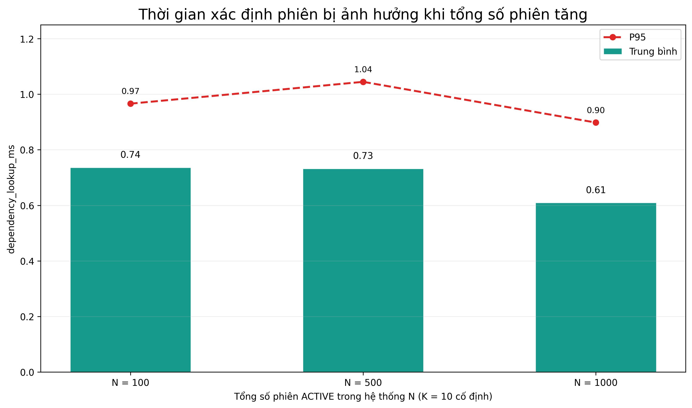
  <figcaption><i>Hình 17. Chi phí xác định phiên bị ảnh hưởng gần như phẳng khi N tăng</i></figcaption>
</figure>

<figure align="center">
  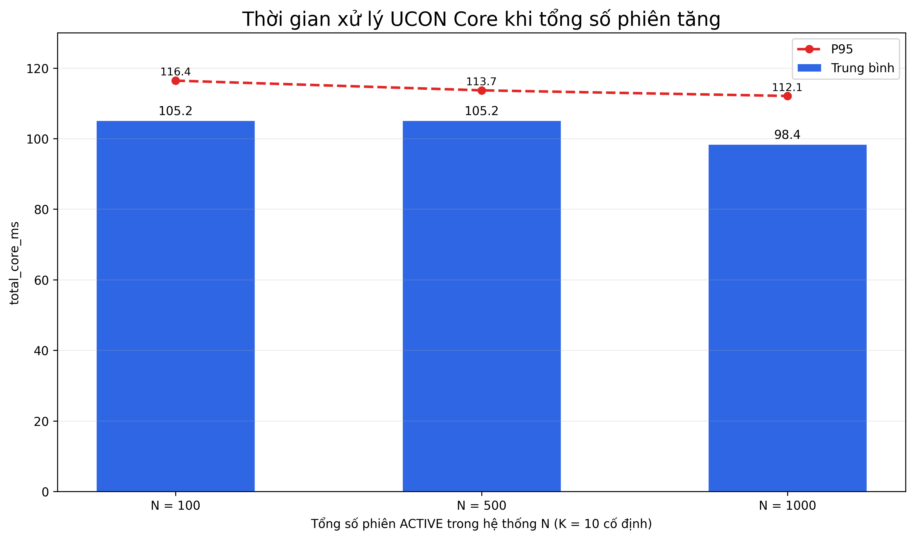
  <figcaption><i>Hình 18. Tổng chi phí xử lý event không tăng theo N khi K cố định</i></figcaption>
</figure>

## 9.3. Phân tích kết quả

**Chi phí xác định phiên liên quan không tỉ lệ với N.** Khi N tăng gấp 10 lần (từ 100 lên 1000), `dependency_lookup_ms` trung bình không tăng mà dao động nhẹ quanh mức dưới một mili-giây: `0,736 ms`, `0,733 ms` rồi `0,610 ms`. Khoảng chênh giữa các mức N chỉ khoảng `0,13 ms`, tương ứng biến thiên rất nhỏ ở mức tuyệt đối (chỉ số này vốn dưới `1 ms` nên chịu ảnh hưởng của nhiễu đo). Điều quan trọng là **không có xu hướng tăng theo N** – thậm chí mức `N = 1000` còn cho giá trị thấp hơn `N = 100`.

<figure align="center">
  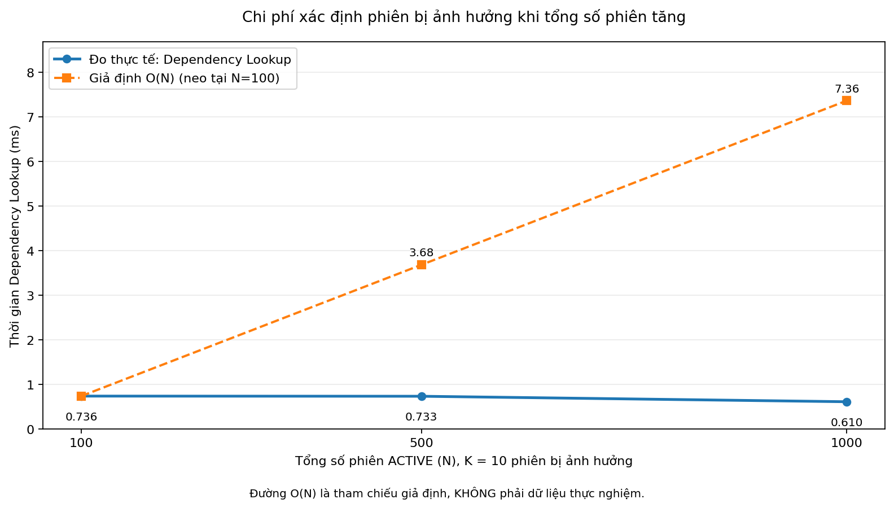
  <figcaption><i>Hình 19. So sánh chi phí đo được với giả định quét toàn bộ N phiên</i></figcaption>
</figure>

Hình 19 minh họa ý nghĩa của kết quả này. Nếu UCON Core phải duyệt toàn bộ N phiên đang hoạt động để tìm ra phiên bị ảnh hưởng, chi phí sẽ tăng tuyến tính theo N (đường tham chiếu đứt nét, đạt khoảng `7,4 ms` ở `N = 1000`). Nhưng giá trị đo được vẫn nằm phẳng quanh `0,6–0,74 ms`. Kết quả này phù hợp với cơ chế theo dõi quan hệ phụ thuộc: hệ thống truy vấn trực tiếp các phiên liên quan đến dữ liệu thay đổi thông qua bảng `usage_session_dependencies`, thay vì tái đánh giá toàn bộ phiên đang hoạt động.

**Tổng chi phí xử lý event cũng ổn định theo N.** `total_core_ms` trung bình gần như không đổi giữa các mức N (`105,2 ms`, `105,2 ms`, `98,4 ms`), và các thành phần chính (PIP, POST, phần chưa phân rã) cũng ổn định vì chúng phụ thuộc vào K – vốn được giữ cố định ở 10 – chứ không phụ thuộc N. Sự sụt nhẹ ở `N = 1000` (khoảng `6,8 ms`, tương đương ~6%) nằm trong biên dao động của phép đo và không thể hiện xu hướng tăng theo N.

Các chỉ số như `poller_wait_ms`, `event_end_to_end_latency_ms` và `last_revoke_latency_ms` không được dùng làm bằng chứng chính về scalability vì chúng chịu ảnh hưởng của vị trí ngẫu nhiên của sự kiện trong chu kỳ poller `1000 ms`.

### Nhận xét

Trong phạm vi thử nghiệm, khi số phiên bị ảnh hưởng được giữ cố định ở 10, việc tăng tổng số phiên đang hoạt động từ 100 lên 1000 **không làm tăng đáng kể** chi phí xác định và xử lý các phiên liên quan. Chi phí xử lý một event được chi phối bởi K (số phiên bị ảnh hưởng), chứ không phải bởi N (tổng phiên trong hệ thống). Đây là một tính chất quan trọng đối với khả năng mở rộng: hệ thống có thể phục vụ nhiều phiên đồng thời mà chi phí xử lý một sự kiện thu hồi vẫn được quyết định bởi phạm vi ảnh hưởng thực tế của sự kiện đó, không phải bởi tổng tải của hệ thống. Kết quả này chỉ đánh giá phía UCON Core/backend; thời gian truyền qua WebSocket và xử lý phía UI nằm ngoài phạm vi đo.

---

# PHẦN III. NHẬN ĐỊNH CHUNG

## 1. Ảnh hưởng của poller

Kết quả kịch bản 1 cho thấy chu kỳ poller ảnh hưởng trực tiếp đến thời gian event chờ trước khi được xử lý. Khi interval tăng, detection latency và revoke latency tăng theo, trong khi processing time của UCON Core gần như không đổi.

Kịch bản idle polling cho thấy mặt còn lại của vấn đề: interval càng ngắn thì số lượt poll rỗng càng lớn. Vì vậy, không thể chỉ giảm poller interval để tối thiểu hóa latency mà bỏ qua chi phí xử lý nền.

Trong các mức được khảo sát, `1000 ms` được sử dụng như một cấu hình đại diện vì nằm ở vùng tương đối cân bằng giữa hai yếu tố trong bộ dữ liệu hiện tại. Giá trị này không được xem là cấu hình tối ưu chung cho mọi hệ thống.

## 2. Ảnh hưởng của số phiên bị tác động

Khi số phiên bị ảnh hưởng tăng từ 1 lên 100, processing time của một event và `total_core_ms` đều tăng rõ rệt. Kịch bản 5 cho thấy trong phạm vi các mức đã đo, `total_core_ms` có xu hướng tăng gần tuyến tính theo K, nhưng kết quả này chỉ mô tả hành vi thực nghiệm và không dùng để suy ra độ phức tạp thuật toán.

Chi phí chuẩn hóa trên mỗi phiên có xu hướng giảm khi K tăng, cho thấy tổng chi phí không tăng bằng cách nhân trực tiếp trường hợp K=1 với số phiên. Hiện tượng này có thể liên quan đến các chi phí cố định ở cấp event, warm-cache hoặc các thao tác được dùng chung, nhưng dữ liệu hiện tại chưa đủ để quy nguyên nhân cho một cơ chế cụ thể.

## 3. Ảnh hưởng của scheduler

Đối với timer-based, tổng revoke latency không chỉ phụ thuộc scheduler mà còn chịu thêm thời gian event chờ poller.

Khi scheduler và poller có chu kỳ giống nhau ở mức `1000 ms`, sự tương tác về thời điểm chạy của hai tác vụ có thể làm `TIMER_DUE` chờ gần một chu kỳ poller đầy đủ. Vì vậy, hai tham số nên được lựa chọn phối hợp thay vì chỉ tối ưu riêng từng interval.

## 4. Ảnh hưởng của xử lý hậu sử dụng

Phép đo phân rã ở kịch bản 5 cho thấy `post_processing_ms` là thành phần được instrument riêng có tỷ trọng lớn nhất trong `total_core_ms`, khoảng `43%` ở K=100. Kết quả này củng cố nhận xét rằng xử lý hậu sử dụng là một phần quan trọng của chi phí Core khi một event tác động đến nhiều phiên.

Tuy nhiên, cần phân biệt `post_processing_ms` với toàn bộ phần thời gian sau revoke. Các thao tác nằm ngoài timer POST vẫn có thể xuất hiện trong `unattributed_core_ms`; vì vậy không nên quy toàn bộ phần tăng của Core cho riêng một hàm hoặc một truy vấn POST.

## 5. Phân rã chi phí bên trong UCON Core

Kịch bản 5 tách `total_core_ms` thành các timer không chồng lấp. Ở K=100, cơ cấu trung bình gồm:

```text
POST Processing      ≈ 42,98%  (337,94 ms)
Chưa phân rã         ≈ 27,57%  (216,78 ms)
PIP                  ≈ 26,10%  (205,18 ms)
Revoke Update        ≈  2,60%  ( 20,45 ms)
PDP                  ≈  0,38%  (  2,98 ms)
Dependency Lookup    ≈  0,28%  (  2,19 ms)
Revoke Publish       ≈  0,10%  (  0,76 ms)
```

POST Processing là thành phần được instrument riêng có thời gian lớn nhất. PIP và `unattributed_core_ms` cũng đóng góp đáng kể, trong khi PDP chỉ chiếm tỷ trọng nhỏ. Điều này cho thấy trong benchmark hiện tại, policy evaluation không phải nơi tập trung phần lớn Core time.

`unattributed_core_ms` vẫn nằm trong UCON Core và có thể gồm điều phối của `ContextHandler`, một số thao tác `UsageSessionManager`, các truy vấn session/dependency/policy metadata, kiểm tra trạng thái, dựng request/context và ghi `session_events`. Phần này cần được instrument sâu hơn nếu muốn xác định chính xác chi phí của từng thao tác.

## 6. Khả năng mở rộng theo tổng số phiên hoạt động

Kịch bản 6 bổ sung một góc nhìn quan trọng về khả năng mở rộng. Khi giữ cố định số phiên bị ảnh hưởng `K = 10` và tăng tổng số phiên đang hoạt động `N` từ 100 lên 1000, cả `dependency_lookup_ms` lẫn `total_core_ms` đều không tăng theo N. Chi phí xử lý một event được quyết định bởi phạm vi ảnh hưởng thực tế của sự kiện (K), chứ không phải bởi tổng tải hiện có của hệ thống (N).

Kết quả này phù hợp với cơ chế theo dõi quan hệ phụ thuộc: hệ thống truy vấn trực tiếp các phiên liên quan thay vì quét toàn bộ phiên đang hoạt động. Đây là một tính chất thuận lợi cho việc mở rộng số phiên đồng thời, trong phạm vi các mức N đã thử nghiệm.

## 7. Hạn chế còn lại và hướng đo tiếp theo

Các phép đo mới đã làm rõ hai vấn đề quan trọng:

1. bên trong UCON Core, POST Processing, PIP và `unattributed_core_ms` là các nhóm đóng góp phần lớn thời gian khi K tăng, trong khi PDP chỉ chiếm tỷ trọng nhỏ;
2. khi giữ K cố định, kịch bản 6 cho phép quan sát riêng ảnh hưởng của tổng số phiên hoạt động N.

Các hạn chế còn lại:

- `unattributed_core_ms` vẫn chiếm khoảng `27–31%` `total_core_ms`; cần đặt thêm timer nếu muốn tách rõ thời gian Context Handler orchestration, Session Manager, truy vấn DB, context building và ghi audit/event;
- kịch bản 5 chỉ đo backend/UCON Core. `revoke_publish_ms` kết thúc ở bước phát application event nội bộ, không bao gồm phần AFTER_COMMIT WebSocket và frontend;
- quan hệ tăng theo K được quan sát ở bốn mức `1, 10, 50, 100`; không nên dùng benchmark để khẳng định Big-O;
- nếu cần đánh giá độ trễ người dùng cảm nhận, cần bổ sung phép đo từ lúc transaction commit đến khi PEP/UI thực sự nhận và áp dụng thông báo thu hồi.

---

# KẾT LUẬN

Kết quả phân tích cho thấy UCON Core Service hoạt động đúng theo luồng thiết kế của nguyên mẫu, nhưng latency quan sát được chịu ảnh hưởng bởi cả cơ chế phát hiện sự kiện và lượng công việc cần xử lý sau khi event được phát hiện.

Đối với cơ chế event-driven, phần lớn độ trễ ở các interval lớn đến từ thời gian chờ poller. Đối với cơ chế timer-based, tổng latency gồm thêm thời gian scheduler phát hiện mốc đến hạn, và hai chu kỳ scheduler–poller cần được phối hợp để tránh hiện tượng trùng pha. Như vậy, nhóm **chi phí chờ do kiến trúc phát hiện định kỳ** (poller và scheduler) là yếu tố chi phối độ trễ phản ứng và có thể điều chỉnh bằng cách chọn interval phù hợp.

Đối với nhóm **chi phí xử lý thực sự bên trong UCON Core**, bộ phép đo mới đã đi từ quan sát tổng thể sang phân rã chi tiết. Khi một event ảnh hưởng đến nhiều phiên, `total_core_ms` có xu hướng tăng gần tuyến tính trong phạm vi các mức K đã đo. Phần lớn Core time nằm ở **POST Processing**, **PIP** và **`unattributed_core_ms`**, trong khi **PDP** chỉ chiếm tỷ trọng nhỏ. Ngược lại, khi chỉ tăng tổng số phiên đang hoạt động N mà giữ K cố định, chi phí xử lý **không tăng theo N**, cho thấy cơ chế theo dõi quan hệ phụ thuộc giúp hệ thống mở rộng tốt theo tổng tải.

Tổng hợp lại, hiệu năng của hệ thống được quyết định bởi ba yếu tố tương đối độc lập:

- **chu kỳ tác vụ nền** (poller, scheduler) – chi phối độ trễ phát hiện và thu hồi;
- **số phiên bị ảnh hưởng K** – chi phối chi phí xử lý một event, chủ yếu qua POST và PIP;
- **tổng số phiên hoạt động N** – gần như không ảnh hưởng đến chi phí xử lý một event.

Vì vậy, cấu hình thực tế nên được chọn dựa trên sự cân bằng giữa yêu cầu thu hồi nhanh và chi phí xử lý nền. Với chi phí xử lý Core, các khu vực đáng ưu tiên khảo sát sâu hơn là POST Processing, PIP và `unattributed_core_ms`. Hướng đo tiếp theo là phân rã phần `unattributed_core_ms` còn lại và mở rộng phạm vi đánh giá sang thời gian truyền thông báo tới PEP/UI để phản ánh đầy đủ độ trễ mà người dùng cảm nhận.
